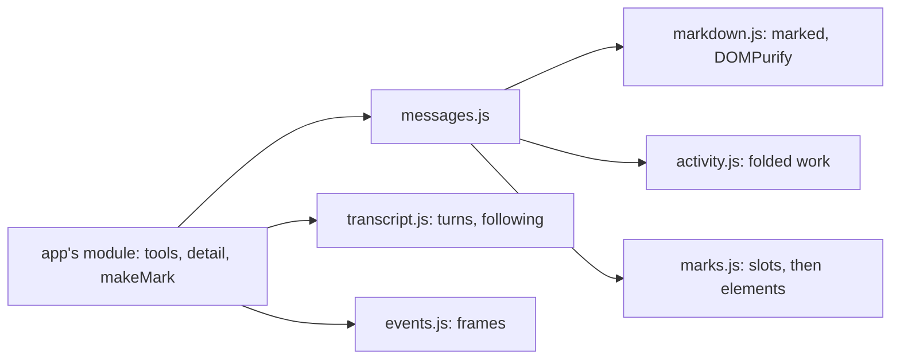

# 0006 — chat-ui: a chat page's transcript, shared

- Date: 2026-11-25
- Status: accepted, built. Consumers: legal-assistant (its 0043) and fitness (its 0015).
  The chat app, where it came from, does not use it yet.

## Context

The same transcript problems had been solved several times in different apps, and the fixes
did not travel: following a stream, rows that close themselves, links that leave the chat,
re-parsing a growing answer, sanitising. The chat app's rebuild (its 0075) solved them
together, with tests in three browser engines. Its 0077 weighs the ways of sharing that.

## Decisions

### D1 — What is in it

| Part | In | Why |
|---|---|---|
| Markdown, activity lines, messages, marks, following the stream, reading frames, their CSS | ✅ | The hard parts, the same everywhere |
| Sending, stopping, recovering, composer, sidebar | ❌ | Where the apps differ for real reasons |
| Code highlighting, maths, file and dashboard cards, source marks | ❌ not yet | Only the chat app has them |
| Event names, routes, tool names | ❌ | The consumer's. It passes its tools in |

### D2 — How it is delivered

| Option | Chosen | Why |
|---|---|---|
| **Static ES modules in a dependency-free Python package** | ✅ | No build; the uv git pin the apps already use |
| npm or a bundle | ❌ | A toolchain no consumer has |
| A hashed path or an import map | ❌ for now | `/chat-ui/` with `no-cache` needs neither, and no inline script under a strict CSP. The chat app has its own hashed URLs, for cold starts |

### D3 — What an app may add to an answer

| Option | The model can forge it | Works in bold, tables, code | Chosen |
|---|---|---|---|
| HTML in the markdown, let through the sanitiser | ❌ yes | ⚠️ | ❌ |
| **Offsets from the server, elements put in after sanitising** | ✅ no | ✅ | ✅ |

`verify.annotate` (HTML) is replaced by `verify.marks` (data) for this reason. Slots hold the
places while the block goes through markdown. Their name has a random word in it, made when
the page loads, so a model cannot write a slot either.

A model can still type "✓". It is plain text with no colour, link or explanation.

### D4 — A question is plain text

Markdown of what a person typed or pasted turns an indented passage into code. It is drawn as
typed. The chat app draws markdown, and would need that back.

## How it works

Serve `chat_ui.STATIC_DIR` at `/chat-ui/` with `Cache-Control: no-cache`, link `chat-ui.css`
**before** the app's own stylesheet, put `chat-ui` on an ancestor of the transcript and of the
composer's `.dock`, and set the `--cu-*` tokens there. `settle` before `mark`.

## Consequences

- **Safari lost the place of a reader who had scrolled back** when a settled answer was drawn
  whole: 4 runs in 8, and 0 in 16 with a layout forced as the content is swapped
  (`transcript.js`). The test is in fitness
  (`test_reading_back_during_a_reply_is_left_alone`), whose page shows it.
- Until the chat app uses this, its transcript and this one are two copies.
- Needs `light-dark()` (Chrome 123, Firefox 120, Safari 17.5) for the default colours only.
- `scripts/build_vendor.sh` builds marked and DOMPurify. They are parsers of untrusted text:
  bump them when an advisory says so.
