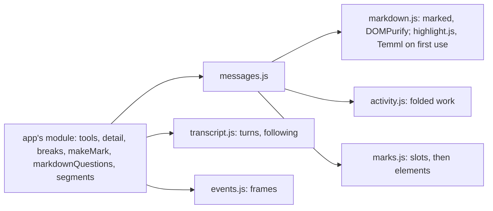

# 0006 — chat-ui: a chat page's transcript, shared

- Date: 2026-11-25
- Status: accepted, built. Consumers: legal-assistant (its 0043), fitness (its 0015) and,
  since 2026-11-26, the chat app it came from (its 0078; see D5).

## Context

The same transcript problems had been solved several times in different apps, and the fixes
did not travel: following a stream, rows that close themselves, links that leave the chat,
re-parsing a growing answer, sanitising. The chat app's rebuild (its 0075) solved them
together, with tests in three browser engines. Its 0077 weighs the ways of sharing that.

## Decisions

### D1 — What is in it

| Part | In | Why |
|---|---|---|
| Markdown, activity lines, messages, marks, following the stream, reading frames, their CSS | ✅ | The hard parts, the same everywhere |
| Sending, stopping, recovering, composer, sidebar | ❌ | Where the apps differ for real reasons |
| Code highlighting and maths | ✅ since D5 | Loaded on first use, so an app whose answers have neither pays nothing |
| File and dashboard cards, source marks | ❌ hooks only (D5) | The chat app's records and routes |
| Event names, routes, tool names | ❌ | The consumer's. It passes its tools in |

### D2 — How it is delivered

| Option | Chosen | Why |
|---|---|---|
| **Static ES modules in a dependency-free Python package** | ✅ | No build; the uv git pin the apps already use |
| npm or a bundle | ❌ | A toolchain no consumer has |
| A hashed path or an import map | ❌ for now | `/chat-ui/` with `no-cache` needs neither, and no inline script under a strict CSP. The chat app has its own hashed URLs, for cold starts |

### D3 — What an app may add to an answer

| Option | The model can forge it | Works in bold, tables, code | Chosen |
|---|---|---|---|
| HTML in the markdown, let through the sanitiser | ❌ yes | ⚠️ | ❌ |
| **Offsets from the server, elements put in after sanitising** | ✅ no | ✅ | ✅ |

`verify.annotate` (HTML) is replaced by `verify.marks` (data) for this reason. Slots hold the
places while the block goes through markdown. Their name has a random word in it, made when
the page loads, so a model cannot write a slot either.

A model can still type "✓". It is plain text with no colour, link or explanation.

### D4 — A question is plain text, unless the app says otherwise

Markdown of what a person typed or pasted turns an indented passage into code. It is drawn as
typed by default. The chat app's people write markdown (fenced code), so `markdownQuestions`
draws it there (D5).

### D5 — What the chat app needed (2026-11-26)

| Need | How | Why this way |
|---|---|---|
| Highlighting and maths | In `markdown.js`, highlight.js and Temml loaded on first use; their classes and MathML let through | Every app can use them; an app without code or maths never loads either |
| Questions as markdown, and edited | `markdownQuestions`; `setQuestion(message, text)` | A policy per app, not per message |
| Cards and a check panel in the timeline | `segments: { type: (message, segment) => … }` | The app's records and routes stay the app's. A card holds one segment, so following a turn no longer draws it again when words follow it (a dashboard reloaded) |
| A queued question that must not take the answer's room | `addTurn(message, { after, live })`, `markLive` | Defaults as before, so legal and fitness are unchanged |
| A note on a step still running, the page being read | `noteRunning(message, text)`; a tool's `running(detail)` | The words are the app's |
| A step's whole result for the app | kept as `step._result` | Source marks read what each call opened |
| Hashed URLs for a year-long cache | the app's own; `<meta name="chat-ui-icons">` names the sprite's | A module cannot work out a hash, and the default needs none |

That is six options to `createMessages` (`tools`, `detail`, `breaks`, `makeMark`,
`markdownQuestions`, `segments`), one more than the "about five" the pilot set as its stop
line. Each is a real difference between apps; none is a mode nobody uses.

The chat app took its CSS improvements here too: a running step's note in italics and the
warning colour only for a step that failed or was interrupted, the jump button fading in,
actions held while their menu is open, rounded images, the 44px Copy on a code block on touch
(the 32px rule had outranked the touch rule), and padding clear of a notch. Its page was
pixel-identical before and after in 12 screenshots (Chromium and WebKit; desktop, phone and
touch; light and dark).

## How it works

Serve `chat_ui.STATIC_DIR` at `/chat-ui/` with `Cache-Control: no-cache`, link `chat-ui.css`
**before** the app's own stylesheet, put `chat-ui` on an ancestor of the transcript and of the
composer's `.dock`, and set the `--cu-*` tokens there. `settle` before `mark`.

An app whose own CSS is in cascade layers imports `chat-ui.css` into a layer of its own
instead, above its general components (whose `.icon-button` would otherwise restyle the
package's) and below its pages, which then add to the package without a specificity fight.

## Consequences

- **Safari lost the place of a reader who had scrolled back** when a settled answer was drawn
  whole: 4 runs in 8, and 0 in 16 with a layout forced as the content is swapped
  (`transcript.js`). The test is in fitness
  (`test_reading_back_during_a_reply_is_left_alone`), whose page shows it.
- Needs `light-dark()` (Chrome 123, Firefox 120, Safari 17.5) for the default colours only.
- `scripts/build_vendor.sh` builds marked, DOMPurify, highlight.js (a subset of languages)
  and Temml. All four parse untrusted text: bump them when an advisory says so.
